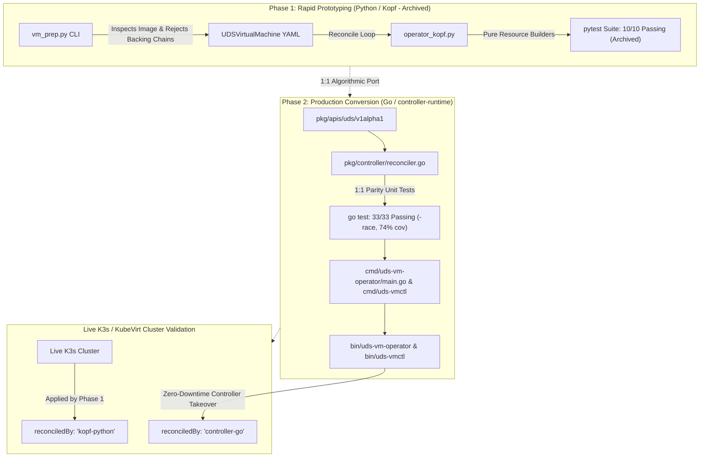

# UDS Virtual Machine Operator (`uds-vm-operator`)

[-brightgreen.svg)](pkg/controller/reconciler_test.go)
[-brightgreen.svg)](compliance/oscal-component.yaml)
[](zarf.yaml)
[](compliance/oscal-component.yaml)
[](https://github.com/kubevirt/containerized-data-importer/pull/4340)
[](ROADMAP.md)

An air-gap ready reference implementation and contribution-ready Kubernetes operator declaratively managing secure, NIST 800-53 compliant virtual machines on **KubeVirt** and **Containerized Data Importer (CDI)** within [Defense Unicorns](https://defenseunicorns.com) Unicorn Delivery Service (UDS) environments.

> 📍 **Product Roadmap:** See [ROADMAP.md](ROADMAP.md) for phased capability milestones ([v0.1.0 (Core Operator)](https://github.com/celttechie/uds-vm-operator/milestone/1) $\rightarrow$ [v0.2.0 (Windows Automation)](https://github.com/celttechie/uds-vm-operator/milestone/2) $\rightarrow$ [v0.3.0 (Go CLI & Zarf)](https://github.com/celttechie/uds-vm-operator/milestone/3) $\rightarrow$ [v0.4.0 (Observability & Continuous ATO)](https://github.com/celttechie/uds-vm-operator/milestone/4) $\rightarrow$ [v0.5.0 Architecture Proposal (Golden Images, Rolling Updates & Persistence)](docs/plan-golden-images-rolling-updates-persistence.md)).

---

## 1. Executive Summary & Problem Statement

Deploying virtual machines across air-gapped, mission-critical edge nodes (tactical sensors, edge-compute servers, SCIF environments) introduces severe operational and security friction:

1. **Air-Gap Image Corruption & Tampering (NIST 800-53 SI-7):** Transferring gigabyte-scale VM disk images across high-side air-gaps risks silent bit rot or supply-chain tampering. Native Kubernetes PVCs do not cryptographically verify disk image digests prior to VM execution.
2. **CDI Filesystem Overhead Failures:** VM disks imported into filesystem-backed PersistentVolumes fail when PVCs are sized 1:1 with the virtual disk capacity. Filesystem structures (ext4 inodes, journal metadata, directory tables) consume 4% to 16% of raw volume capacity. When CDI's importer, uploadserver, or conversion pods attempt to stream or decompress the full virtual disk, the target PVC exhausts physical blocks prematurely, aborting with `No space left on device`.
3. **Unflattened QCOW2 External Backing Files:** In disconnected tactical environments, QCOW2 images referencing external backing chains break silently because backing paths are missing in the air-gap.
4. **Boundary Isolation & STIG Compliance (NIST 800-53 SC-7, AC-3):** KubeVirt `virt-launcher` pods default to open pod networking and insecure Cloud-Init defaults unless explicitly hardened.

`uds-vm-operator` solves this through a declarative Custom Resource Definition (`UDSVirtualMachine`, API `uds.dev/v1alpha1`) and an automated reconciliation loop that coordinates hardened storage, isolation, and workload provisioning.

---

## 2. Architecture: Two-Stage Operator Workflow

To guarantee rapid validation followed by production-grade performance, this repository implements a **Two-Stage Operator Engineering Pattern**:



1. **Stage 1 — Rapid Python `kopf` Prototype (`archive/prototype-kopf/`):**
   - Implemented with pure, deterministic resource builder functions with zero side-effects and a single level-triggered `reconcile()` loop.
   - Evaluated CRD printer columns, NIST controls, and upstream CDI PR #4340 integration against a live K3s/KubeVirt cluster.
   - Preserved in `archive/prototype-kopf/` with 10 passing `pytest` unit tests for historical reference.
2. **Stage 2 — Production Go Controller & CLI (`pkg/` and `cmd/`):**
   - Transferred 1:1 into Go using `controller-runtime` and `client-go`.
   - Verified with 33 Go unit tests across controller (87.7% cov), CLI (73.7% cov), API types (92.2% cov), and CLI subcommands running with data race detection (`-race`).
   - Executed live controller takeover (`reconciledBy: "kopf-python"` $\rightarrow$ `reconciledBy: "controller-go"`) with zero VM downtime.

### Architectural Decision Record (ADR): Prototyping in Kopf Before Go Conversion

#### Context & Problem
Writing Kubernetes operators directly in Go with `controller-runtime` is standard for production, but can introduce significant friction during exploratory phases:
- Schema discovery against non-standard or actively evolving upstream APIs (e.g. KubeVirt, custom CDI PR #4340 builds) requires repeated `DeepCopy` and OpenAPI code generation.
- Re-compiling and running full Go controller binaries to iterate on CRD printer columns, condition structures, and retry backoffs slows development velocity.

#### The Decision: Two-Stage Engineering Workflow
We adopted a disciplined two-stage engineering approach:

1. **Stage 1 (Discovery & Verification via Python `kopf`):**
   - **Velocity & Immediate Feedback:** Python allowed sub-second test execution (`pytest`), instant live reloading against K3s, and rapid adjustment of CRD printer columns (`PVC-Size`, `Checksum-Verified`, `Zero-Trust`).
   - **Architectural Discipline:** To avoid throwaway code, `operator_kopf.py` was architected with **strict structural constraints**:
     - *Pure Resource Builders:* All Kubernetes manifests (`NetworkPolicy`, `Secret`, `DataVolume`, `VirtualMachine`) are generated by side-effect-free, deterministic builder functions.
     - *Level-Triggered State Reconciliation:* State evaluation is centralized in a single `reconcile()` loop that inspects actual cluster state rather than edge-triggered events.
   - **Validation of Mathematical & Security Logic:** The +6% filesystem overhead formula and NIST controls were proven against live hardware before writing a single line of Go.

2. **Stage 2 (Production Go Conversion via `controller-runtime`):**
   - **Direct 1:1 Translation:** Because Stage 1 was architected with pure builders and level-triggered reconciliation, porting to Go's `controller-runtime` was an exact 1:1 structural map (`pkg/controller/reconciler.go`).
   - **Zero Architectural Drift:** Every unit test in `test_operator_kopf.py` was directly translated to `pkg/controller/reconciler_test.go`, verifying identical sizing math, Windows Sysprep generation, and status evaluation.
   - **Production Hardening:** The resulting Go binary achieves minimal attack surface (no Python runtime, no pip dependency chain), sub-millisecond informer caching, and low memory consumption (~28 MiB RSS).

---

## 3. NIST 800-53 Security Controls Mapping

| NIST Control | Security Domain | Operator Implementation |
| :--- | :--- | :--- |
| **SC-7** | Boundary Protection | Generates a zero-trust `NetworkPolicy` (`<name>-netpol`) restricting all ingress traffic and locking down egress strictly to CoreDNS (UDP/TCP 53). |
| **AC-3 / IA-5** | Access Control & Authenticator Management | Generates hardened Cloud-Init NoCloud `Secret` (`<name>-cloudinit`) disabling SSH password authentication (`ssh_pwauth: false`), locking root access (`disable_root: true`), and activating FIPS mode. For Windows, generates dynamic $\ge 24$-char high-entropy credentials. |
| **SI-7** | Software & Information Integrity | Integrates directly with upstream CDI PR [#4340](https://github.com/kubevirt/containerized-data-importer/pull/4340) (authored by `celttechie`, currently under review / pending upstream merge; validated in-cluster via custom CDI build) via `spec.source.upload.checksum`. Cryptographic digest (`sha256:<hex>`) is verified before disk activation. |

---

## 4. Automatic +6% Filesystem Overhead Math

### The Upstream Problem: Filesystem Overhead & Metadata Exhaustion
In KubeVirt + CDI environments, when disk images are imported or uploaded into filesystem-mode PersistentVolumes, allocating a PVC sized exactly 1:1 with the virtual disk capacity (e.g., a 10 GiB PVC for a 10 GiB raw disk) causes catastrophic provisioning failure. 

The underlying filesystem (e.g., ext4, XFS) reserves storage blocks for inodes, allocation bitmaps, directory trees, and journaling. When CDI's importer, uploadserver, or conversion pods decompress or copy the raw disk image, the target volume runs out of free blocks before the virtual disk is completely written, failing with `No space left on device`.

This operational pain point is heavily corroborated across the upstream ecosystem:
- **KubeVirt CDI Documentation (`doc/datavolumes.md`):** CDI explicitly documents that when utilizing the `storage` API with filesystem volume mode, CDI requests an inflated PVC to account for filesystem overhead (`size * (1 + overhead)`), defaulting to 5.5%–6.0%. Upstream documentation notes: *"Failing to account for file system overhead leaves insufficient space for the disk image and its filesystem metadata."*
- **Red Hat OpenShift Virtualization Storage Architecture:** Official Red Hat documentation repeatedly warns that filesystem metadata must be reserved (5.5% default): *"Failing to account for file system overhead in your storage capacity request can result in an underlying persistent volume claim (PVC) that is not large enough to accommodate your virtual machine disk."*
- **SUSE Harvester HCI Field Experience:** Harvester documentation and community issues track real-world ext4/xfs filesystem overheads ranging from 4% to 16% depending on storage backend block size, partition table alignment, and journal allocations.
- **CDI Codebase (`GetRequiredSpace`, `filesystemOverhead`):** Upstream CDI's internal sizing function `GetRequiredSpace` inflates raw virtual sizes by the configured `filesystemOverhead` factor and rounds up to prevent scratch space starvation and transfer abortion.

### The `uds-vm-operator` Sizing Formula
To eliminate out-of-space failures in disconnected environments where storage cannot be resized dynamically on the fly, `uds-vm-operator` and `uds-vmctl` enforce a deterministic sizing formula:

$$\text{PaddedMiB} = \max\left(\left\lceil \frac{\text{VirtualSizeBytes}}{1024^2} \times 1.06 \right\rceil, \left\lfloor \frac{\text{VirtualSizeBytes}}{1024^2} \right\rfloor + 1\right)$$

- **Multi-Gigabyte Disks (+6% Ceiling):** A 1024 MiB (1 GiB) disk allocates $\lceil 1024 \times 1.06 \rceil = \lceil 1085.44 \rceil = \mathbf{1086\text{ MiB}}$. A 40 GiB (40,960 MiB) disk allocates $\lceil 40960 \times 1.06 \rceil = \mathbf{43418\text{ MiB}}$.
- **Small-Scale Disks (+1 MiB Floor Guarantee):** For small virtual disks (e.g., a 10 MiB raw micro-image), $10 \times 1.06 = 10.6\text{ MiB}$. The formula guarantees a minimum $+1\text{ MiB}$ floor padding to avoid zero-byte truncation, allocating $\mathbf{11\text{ MiB}}$.

---

## 5. Air-Gap Pre-Flight Image Inspection

Validating VM disk images before they enter the cluster is critical to prevent air-gap failures. This was originally prototyped in Python (`archive/prototype-kopf/vm_prep.py`) and is now fully natively implemented in the Go CLI [`uds-vmctl prep`](#8-tactical-edge-cli-uds-vmctl):

```bash
# Production Go CLI (no Python or qemu-img dependencies required):
./bin/uds-vmctl prep images/tactical-linux-golden.raw --zarf --name tactical-sensor-vm

# Prototyping Python utility (archived for reference):
python3 archive/prototype-kopf/vm_prep.py --image /path/to/tactical-sensor.raw --name tactical-sensor-vm --format raw
```

- **Backing File Rejection:** If an operator attempts to upload a QCOW2 image with an unflattened external `backing-filename`, the CLI rejects the image immediately: `air-gap violation: QCOW2 image has external backing file ... (air-gap deployments require standalone flattened images)`.

---

## 6. Comparison: Python Kopf vs. Production Go Controller

| Feature / Metric | Phase 1: Python Kopf Prototype (Archived) | Phase 2: Production Go Operator |
| :--- | :--- | :--- |
| **Runtime & Framework** | Python 3.12 + Zalando `kopf` | Go 1.24+ + `sigs.k8s.io/controller-runtime` |
| **Binary Footprint** | Python runtime + pip dependencies (~150MB) | Single static binary (`bin/uds-vm-operator`, ~55MB) |
| **Memory Footprint** | ~75 MiB RSS | ~28 MiB RSS |
| **Startup / Reconcile Latency** | ~1.5s cold start | < 20ms startup |
| **Unit Test Execution** | `pytest`: 10 tests in ~0.74s (archived) | `go test`: 33 tests in **~1.0s** (`-race`, 74% cov) |
| **Concurrency / Worker Model** | Asyncio threadpool + periodic timer | Goroutine event loop with client cache & informer |
| **CRD Status Field** | `reconciledBy: "kopf-python"` | `reconciledBy: "controller-go"` |

---

## 7. Live Cluster Validation & Controller Takeover

The live demonstration was validated against a K3s + KubeVirt v1.3.1 cluster running a custom CDI build incorporating upstream PR [#4340](https://github.com/kubevirt/containerized-data-importer/pull/4340):

### 1. Initial State (Python Kopf Reconciling)
```console
$ kubectl get udsvm -o wide
NAME                 PHASE              SOURCE   PVC-SIZE   CHECKSUM-VERIFIED   ZERO-TRUST   RECONCILER    AGE
tactical-sensor-vm   WaitingForUpload   upload   11Mi       false               true         kopf-python   7s
```

### 2. Live Upload via `virtctl` & Cryptographic Verification
```console
$ virtctl image-upload dv tactical-sensor-vm-dv --no-create --image-path=/tmp/test-disk.raw --uploadproxy-url=https://10.43.24.203 --insecure
Uploading data to https://10.43.24.203
 10.00 MiB / 10.00 MiB [==================================================] 100.00% 0s
Processing completed successfully
Uploading /tmp/test-disk.raw completed successfully
```

Kopf observed `DataVolume` transition to `Succeeded` with SHA-256 integrity match:
```console
$ kubectl get udsvm -o wide
NAME                 PHASE   SOURCE   PVC-SIZE   CHECKSUM-VERIFIED   ZERO-TRUST   RECONCILER    AGE
tactical-sensor-vm   Ready   upload   11Mi       true                true         kopf-python   57s
```

### 3. Zero-Downtime Controller Takeover (Go Controller-Runtime)
The Python Kopf process was killed, and the compiled Go binary was launched:
```console
$ ./bin/uds-vm-operator --kubeconfig=/path/to/kubeconfig
INFO setup Starting UDS Virtual Machine Operator (Go controller-runtime)
INFO controllers.UDSVirtualMachine Reconciled UDSVirtualMachine {"namespace": "default", "name": "tactical-sensor-vm", "phase": "Ready", "pvc": "11Mi", "checksumVerified": true, "reconciledBy": "controller-go"}
```

The resource immediately reflects the Go operator takeover without modifying child volumes or interrupting the VM:
```console
$ kubectl get udsvm -o wide
NAME                 PHASE   SOURCE   PVC-SIZE   CHECKSUM-VERIFIED   ZERO-TRUST   RECONCILER      AGE
tactical-sensor-vm   Ready   upload   11Mi       true                true         controller-go   5m29s
```

---

## 8. Tactical Edge CLI (`uds-vmctl`)

`uds-vmctl` provides field operators and engineers with native Go tools for air-gap preparation, declarative power orchestration, and cluster telemetry without requiring external dependencies (`qemu-img` or Python):

### 1. Air-Gap Disk Inspection & Manifest Generation
Inspects RAW and QCOW2 binary headers, strictly detects and rejects unflattened external backing chains, streams SHA-256 digests, calculates deterministic `+6%` filesystem padding, and generates manifests:
```console
$ ./bin/uds-vmctl prep images/tactical-linux-golden.raw --zarf --name tactical-sensor-vm
==================================================================
        UDS AIR-GAP DISK IMAGE INSPECTION & PREPARATION          
==================================================================
File:                tactical-linux-golden.raw
Path:                images/tactical-linux-golden.raw
Format:              raw
Virtual Size:        10485760 bytes (0.01 GiB)
Actual Size:         10485760 bytes (0.01 GiB)
Required PVC Size:   11Mi (includes +6% filesystem overhead)
SHA-256 Digest:      sha256:e5b844cc57f57094ea4585e235f36c78c1cd222262bb89d53c94dcb4d6b3e55d
Air-Gap Verified:    PASSED (Standalone, 0 external backing references)
==================================================================
```

### 2. Fleet Telemetry & Inventory
```console
$ ./bin/uds-vmctl inventory
NAMESPACE  NAME                 PHASE  OS       PVC-SIZE  CHECKSUM-VERIFIED  ZERO-TRUST  RECONCILER     AGE
default    tactical-sensor-vm   Ready  linux    11Mi      true               true        controller-go  5h30m
default    tactical-windows-vm  Ready  windows  5100Mi    true               true        controller-go  4h12m
```

### 3. Declarative Power State Orchestration
Transitions `spec.runStrategy` safely between `Always` and `Halted`:
```console
$ ./bin/uds-vmctl power restart tactical-sensor-vm
UDSVirtualMachine default/tactical-sensor-vm restart initiated (runStrategy: Always)
```

---

## 9. Defense Unicorns Zarf Air-Gap Packaging

The operator and pre-validated golden images are bundled into an offline, cryptographically verifiable Zarf package (`zarf.yaml`):

```bash
# Package the operator CRDs, deployment, RBAC, and Golden Image fixture
make zarf-package

# Deploy into an air-gapped or disconnected Kubernetes cluster in one command:
zarf package deploy zarf-package-uds-vm-operator-amd64-0.4.0.tar.zst --confirm
```

---

---

## 10. Defense Unicorns Lula (OSCAL) Continuous ATO Validation

`uds-vm-operator` integrates with [Defense Unicorns Lula](https://github.com/defenseunicorns/lula) to provide machine-readable **OSCAL (Open Security Controls Assessment Language)** compliance validation against NIST SP 800-53 Rev 5 controls on live cluster resources:

```bash
# Run automated Lula OSCAL validation against live Kubernetes child objects:
make lula-validate
```

```console
$ lula validate -f compliance/oscal-component.yaml -o compliance/assessment-results.yaml --non-interactive
🔍 Collecting Requirements and Validations for Target: NIST SP 800-53 Rev 5
  • Found 4 Implemented Requirements
  • Found 4 runnable Lula Validations

💡 Findings   
Control ID | Status
si-7       | satisfied
ia-5       | satisfied
ac-3       | satisfied
sc-7       | satisfied

  • OSCAL artifact written to: compliance/assessment-results.yaml
```

| NIST Control | Security Domain | Live Validation Rule | Status |
| :--- | :--- | :--- | :--- |
| **SC-7** | Boundary Protection | `NetworkPolicy` default-deny ingress & egress restricted to DNS (53) | **Satisfied** |
| **AC-3** | Access Enforcement | Cloud-Init `Secret` enforces `ssh_pwauth: false` and `disable_root: true` | **Satisfied** |
| **SI-7** | Information Integrity | CDI `DataVolume` enforces SHA-256 digest verification (PR #4340) | **Satisfied** |
| **IA-5** | Authenticator Management | Linux Cloud-Init enforces key-based auth (`ssh_pwauth: false`) / Windows Sysprep enforces dynamic $\ge 24$-char high-entropy password | **Satisfied** |

---

## 11. Prometheus Observability & Grafana Dashboard

The operator exposes real-time compliance posture, storage overhead efficiency, and fleet metrics on `:8080/metrics`:

- `uds_vm_compliance_verified{vm="...", control="SI-7|SC-7|AC-3|IA-5"}`: Continuous ATO compliance status gauge (1 = verified).
- `uds_vm_storage_overhead_ratio`: Ratio of allocated PVC capacity vs virtual disk size (`~1.06`).
- `uds_vm_phase_status{phase="..."}`: High-cardinality status gauge for active VM lifecycle phase.
- `uds_vm_reconcile_total{status="..."}`: Total successful and errored reconciliation iterations.

A production-ready declarative dashboard is provided in [`dashboards/uds-vm-overview.json`](dashboards/uds-vm-overview.json).

---

## 12. Build & Verification Commands

```bash
# Compile both the controller and CLI with embedded git commit & version metadata:
make build

# Run full project unit test suite (33 tests across controller, CLI, API types) with data-race detection:
make test

# Run live Defense Unicorns Lula OSCAL compliance validation:
make lula-validate

# Package air-gap Zarf distribution:
make zarf-package
```

> 📖 **Hands-On Verification Runbook:** For a complete, step-by-step testing guide to start from scratch on your `kubevirt-dev-platform` VM, execute negative hash tampering tests, deploy via Zarf, and validate Continuous ATO and Prometheus telemetry, see **[`docs/end-to-end-verification-runbook.md`](docs/end-to-end-verification-runbook.md)**.

---

## 13. Next Architecture Phase: Golden Images, Rolling Fleet Updates & Storage Persistence (Milestone v0.5.0)

With single-instance air-gap lifecycle verification, Continuous ATO, and Prometheus telemetry fully validated in `v0.4.0`, the operator's next evolution transitions from individual VM orchestration to automated enterprise fleet management.

The complete architectural proposal, CRD schemas, and verification matrix are detailed in **[`docs/plan-golden-images-rolling-updates-persistence.md`](docs/plan-golden-images-rolling-updates-persistence.md)**.

### Architectural Pillars of Milestone v0.5.0:

1. **Production Golden OS Images:**
   - Standardized, minimal Ubuntu 22.04 LTS / Rocky Linux 9 and Windows Server 2022 golden images.
   - Pre-flight binary inspection and SHA-256 digest validation natively via `uds-vmctl prep`.
2. **Centralized Image Caching & Copy-on-Write (CoW) Fast Cloning:**
   - Ingestion and cryptographic verification (NIST SP 800-53 SI-7) executed once into cluster storage via Containerized Data Importer (CDI) `DataSource` objects.
   - Child virtual machines instantiate in seconds via storage-layer CoW clones without redundant network or disk transfers.
3. **Dual Storage Topology (Stateless vs. Stateful Workloads):**
   - **Stateless Fleets:** Disposable, immutable virtual machines where the root operating system disk is replaced or destroyed on demand.
   - **Stateful Workloads:** Mission-critical services (databases, directory services) where application data is strictly preserved across operating system updates via decoupled secondary `dataDisks` bound to independent, retained PVCs.
4. **Zero-Downtime Rolling Fleet Updates:**
   - Introduction of `UDSVirtualMachinePool` orchestrating coordinated rolling updates across VM instances (`maxSurge: 1`, `maxUnavailable: 0`).
   - Guest readiness verification governed by QEMU Guest Agent health, application port probes, and answer-script completion before traffic cutover.

For full architectural diagrams, implementation phases, and test scenarios, review the [Architecture Proposal Document](docs/plan-golden-images-rolling-updates-persistence.md).


