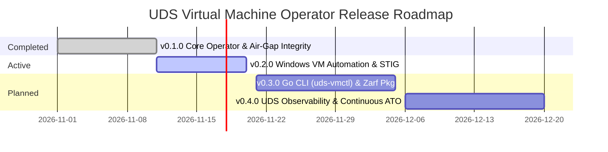

# UDS Virtual Machine Operator (`uds-vm-operator`) — Product Roadmap

This roadmap outlines the phased capability delivery for `uds-vm-operator`, aligning technical milestones with **Defense Unicorns' mission**: delivering secure, repeatable, and compliant virtual machine workloads alongside containers across disconnected and air-gapped environments.

All milestones are tracked live on GitHub: [uds-vm-operator Milestones](https://github.com/celttechie/uds-vm-operator/milestones).

---

---

## [Milestone v0.1.0](https://github.com/celttechie/uds-vm-operator/milestone/1) — Core Operator, Air-Gap Prep & CDI Checksum Integrity (COMPLETED)

### Objective:
Establish the declarative `UDSVirtualMachine` CustomResourceDefinition and demonstrate the two-stage engineering workflow (Python Kopf rapid prototyping $\rightarrow$ production Go controller-runtime conversion) with zero-downtime controller takeover.

### Key Capabilities Delivered:
- **NIST 800-53 SI-7:** Cryptographic upload digest verification (`spec.disk.checksum`) integrating upstream KubeVirt CDI PR [#4340](https://github.com/kubevirt/containerized-data-importer/pull/4340).
- **NIST 800-53 SC-7:** Automated default-deny zero-trust `NetworkPolicy` restricting virt-launcher egress strictly to CoreDNS (53/UDP/TCP).
- **NIST 800-53 AC-3 / IA-5:** Hardened Cloud-Init NoCloud Secret generator enforcing disabled SSH passwords, disabled root, and FIPS mode.
- **Storage Sizing:** Deterministic `+6%` KubeVirt/CDI filesystem allocation padding math protecting PVCs from out-of-space abortion.
- **Air-Gap Image Pre-Flight CLI:** `vm_prep.py` utility inspecting RAW/QCOW2 disks and rejecting unflattened external backing chains.
- **Test Parity:** 7 Python `pytest` tests and 6 Go `controller-runtime` unit tests with identical lifecycle test vectors.

---

## [Milestone v0.2.0](https://github.com/celttechie/uds-vm-operator/milestone/2) — Windows VM Automation, Hyper-V Enlightenments & STIG Hardening (ACTIVE)

### Objective:
Automate mission-critical Windows Server / Windows 11 virtual machines on KubeVirt, eliminating the 4 classic failure modes (`0x7B` BSODs, CPU spinlock stalls, TPM/UEFI boot rejection, and Sysprep answer file injection).

### Planned Capabilities:
- **`spec.osType: windows` & `spec.windowsProfile` CRD Fields:** Declarative tuning for Windows guest OS requirements.
- **KVM Hyper-V Enlightenments:** Automatic injection of `relaxed`, `vapic`, `spinlocks: 8191`, `synic`, `tlbflush`, `frequencies`, and `hypervclock` timers to eliminate host CPU starvation and clock drift.
- **Storage Driver Remediation:** Automated attachment of `virtio-win` driver ISO (`containerDisk`) and transitional SATA bus fallback for un-drivered legacy images.
- **DISA STIG Hardware Security:** Automated injection of UEFI Secure Boot (`firmware.bootloader.efi`), System Management Mode (`features.smm`), and vTPM 2.0 (`devices.tpm`).
- **Automated Sysprep & `Autounattend.xml` Generation:** Zero-touch Windows installer answer-file generator mounting via KubeVirt `sysprep` volume, automating VirtIO driver injection, disk partitioning, and QEMU Guest Agent initialization to eliminate manual GUI interaction.
- **Runbook Documentation:** In-depth troubleshooting guide (`docs/windows-troubleshooting.md`) detailing Windows-on-KubeVirt diagnosis and remediation.

---

## [Milestone v0.3.0](https://github.com/celttechie/uds-vm-operator/milestone/3) — Go CLI (`uds-vmctl`) & Zarf Air-Gap Packaging (PLANNED)

### Objective:
Provide a standalone, air-gap ready Go CLI for offline VM preparation and lifecycle controls, paired with Defense Unicorns Zarf packaging definitions.

### Planned Capabilities:
- **Go CLI (`uds-vmctl`):**
  - `uds-vmctl prep <image>`: Standalone Go binary parsing QCOW2 headers and raw images, computing SHA-256 digests, and outputting `UDSVirtualMachine` and `zarf.yaml` declarations.
  - `uds-vmctl power [start|stop|restart] <vm>`: Operator power controls orchestrating KubeVirt `runStrategy` transitions.
  - `uds-vmctl inventory`: Tabular cluster inventory reporting VM status, OS type, PVC sizing, and STIG compliance.
- **Zarf Package Definition (`zarf.yaml`):**
  - Standalone `.tar.zst` air-gap bundle containing operator image, CDI controller/uploadproxy, and sample tactical VM disk payloads for one-command field deployment (`zarf package deploy`).

---

## [Milestone v0.4.0](https://github.com/celttechie/uds-vm-operator/milestone/4) — Defense Unicorns Lula (OSCAL) Continuous ATO & Prometheus Observability (PLANNED)

### Objective:
Bridge the gap between Kubernetes orchestration and federal authorization by implementing machine-readable **OSCAL (Open Security Controls Assessment Language)** with [Defense Unicorns Lula](https://github.com/defenseunicorns/lula), replacing ad-hoc CI checklist assertions with automated, cryptographically signed Continuous ATO (cATO) evidence.

### Planned Capabilities:
- **Defense Unicorns Lula OSCAL Integration:**
  - `compliance/oscal-component.yaml`: Machine-readable OSCAL component definition detailing controls `SC-7` (Zero Trust Boundary), `AC-3` (Access Enforcement), `SI-7` (Integrity & PR #4340 Checksums), and `IA-5` (Credential Management).
  - Automated Lula validation rules evaluating live KubeVirt child objects (`NetworkPolicy`, `Secret`, `DataVolume`) using Kubernetes domain providers.
  - `lula validate` step in GitHub Actions producing signed `assessment-results.yaml` artifacts on every merge.
- **Custom Prometheus Metrics:**
  - `uds_vm_compliance_verified{vm="...", control="SI-7|SC-7|AC-3"}`: Gauges reporting real-time compliance posture linked to OSCAL control IDs.
  - `uds_vm_storage_overhead_ratio`: Metrics tracking allocated PVC capacity vs virtual disk size.
  - `uds_vm_phase_status`: High-cardinality status gauges tracking `WaitingForUpload`, `Provisioning`, and `Ready`.
- **Grafana Dashboard Definition:** Declarative dashboard JSON visualizing fleet virtualization health, resource overhead, and automated cATO compliance evidence.
