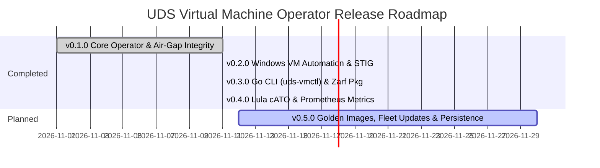

# UDS Virtual Machine Operator (`uds-vm-operator`) — Product Roadmap

This roadmap outlines the phased capability delivery for `uds-vm-operator`, aligning technical milestones with **Defense Unicorns' mission**: delivering secure, repeatable, and compliant virtual machine workloads alongside containers across disconnected and air-gapped environments.

All milestones are tracked live on GitHub: [uds-vm-operator Milestones](https://github.com/celttechie/uds-vm-operator/milestones).

---

---

## [Milestone v0.1.0](https://github.com/celttechie/uds-vm-operator/milestone/1) — Core Operator, Air-Gap Prep & CDI Checksum Integrity (COMPLETED)

### Objective:
Establish the declarative `UDSVirtualMachine` CustomResourceDefinition and demonstrate the two-stage engineering workflow (Python Kopf rapid prototyping $\rightarrow$ production Go controller-runtime conversion) with zero-downtime controller takeover.

### Key Capabilities Delivered:
- **NIST 800-53 SI-7:** Cryptographic upload digest verification (`spec.disk.checksum`) integrating upstream KubeVirt CDI PR [#4340](https://github.com/kubevirt/containerized-data-importer/pull/4340) (under review upstream; validated via custom in-cluster CDI build).
- **NIST 800-53 SC-7:** Automated default-deny zero-trust `NetworkPolicy` restricting virt-launcher egress strictly to CoreDNS (53/UDP/TCP).
- **NIST 800-53 AC-3 / IA-5:** Hardened Cloud-Init NoCloud Secret generator enforcing disabled SSH passwords, disabled root, and FIPS mode.
- **Storage Sizing:** Deterministic `+6%` KubeVirt/CDI filesystem allocation padding math protecting PVCs from out-of-space abortion.
- **Air-Gap Image Pre-Flight CLI:** `vm_prep.py` utility inspecting RAW/QCOW2 disks and rejecting unflattened external backing chains.
- **Test Parity:** 10 Python `pytest` tests (archived) and 15 Go unit tests (10 controller + 5 CLI) passing with `-race` across identical lifecycle test vectors.

---

## [Milestone v0.2.0](https://github.com/celttechie/uds-vm-operator/milestone/2) — Windows VM Automation, Hyper-V Enlightenments & STIG Hardening (COMPLETED)

### Objective:
Automate mission-critical Windows Server / Windows 11 virtual machines on KubeVirt, eliminating the 4 classic failure modes (`0x7B` BSODs, CPU spinlock stalls, TPM/UEFI boot rejection, and Sysprep answer file injection).

### Planned Capabilities:
- **`spec.osType: windows` & `spec.windowsProfile` CRD Fields:** Declarative tuning for Windows guest OS requirements.
- **KVM Hyper-V Enlightenments:** Automatic injection of `relaxed`, `vapic`, `spinlocks: 8191`, `synic`, `tlbflush`, `frequencies`, and `hypervclock` timers to eliminate host CPU starvation and clock drift.
- **Storage Driver Remediation:** Automated attachment of `virtio-win` driver ISO (`containerDisk`) and transitional SATA bus fallback for un-drivered legacy images.
- **DISA STIG Hardware Security:** Automated injection of UEFI Secure Boot (`firmware.bootloader.efi`), System Management Mode (`features.smm`), and vTPM 2.0 (`devices.tpm`).
- **Automated Sysprep & `Autounattend.xml` Generation:** Zero-touch Windows installer answer-file generator mounting via KubeVirt `sysprep` volume, automating VirtIO driver injection, disk partitioning, and QEMU Guest Agent initialization to eliminate manual GUI interaction.
- **Runbook Documentation:** In-depth troubleshooting guide (`docs/windows-troubleshooting.md`) detailing Windows-on-KubeVirt diagnosis and remediation.

---

## [Milestone v0.3.0](https://github.com/celttechie/uds-vm-operator/milestone/3) — Go CLI (`uds-vmctl`) & Zarf Air-Gap Packaging (COMPLETED)

### Objective:
Provide a standalone, air-gap ready Go CLI for offline VM preparation and lifecycle controls, paired with Defense Unicorns Zarf packaging definitions.

### Key Capabilities Delivered:
- **Go CLI (`uds-vmctl`):**
  - `uds-vmctl prep <image>`: Standalone Go binary parsing QCOW2 and RAW binary headers natively, strictly enforcing standalone air-gap flattened disks (rejecting external backing files), streaming SHA-256 digests, computing deterministic `+6%` PVC padding, and generating `UDSVirtualMachine` and `zarf.yaml` declarations.
  - `uds-vmctl power [start|stop|restart] <vm>`: Operator power controls orchestrating KubeVirt `runStrategy` transitions (`Always` vs `Halted`) via `client-go`.
  - `uds-vmctl inventory`: Real-time tabular cluster inventory reporting namespace, phase, OS type, PVC sizing, checksum verification, zero-trust network posture, reconciler identity, and age.
  - `uds-vmctl version`: Dynamic build metadata (commit, date, semantic version) injected via `ldflags`.
- **Defense Unicorns Zarf Air-Gap Packaging (`zarf.yaml`):**
  - Production Zarf package definition bundling CRDs, Operator Deployment & RBAC, pre-validated Golden OS image fixtures with SHA-256 integrity, and sample workloads into a single offline `.tar.zst` air-gap distribution.
- **Enterprise Build Pipeline (`Makefile`):**
  - Unified targets for multi-binary build (`bin/uds-vm-operator`, `bin/uds-vmctl`), unit testing (`make test`), and Zarf air-gap package assembly (`make zarf-package`).

---

## [Milestone v0.4.0](https://github.com/celttechie/uds-vm-operator/milestone/4) — Defense Unicorns Lula (OSCAL) Continuous ATO & Prometheus Observability (COMPLETED)

### Objective:
Bridge the gap between Kubernetes orchestration and federal authorization by implementing machine-readable **OSCAL (Open Security Controls Assessment Language)** with [Defense Unicorns Lula](https://github.com/defenseunicorns/lula), replacing ad-hoc CI checklist assertions with automated, cryptographically signed Continuous ATO (cATO) evidence.

### Key Capabilities Delivered:
- **Defense Unicorns Lula OSCAL Integration:**
  - `compliance/oscal-component.yaml`: Machine-readable OSCAL component definition detailing controls `SC-7` (Zero Trust Boundary), `AC-3` (Access Enforcement), `SI-7` (Integrity & PR #4340 Checksums), and `IA-5` (Credential Management).
  - Automated Lula validation rules evaluating live KubeVirt child objects (`NetworkPolicy`, `Secret`, `DataVolume`) using Kubernetes domain providers.
  - Generates machine-readable `compliance/assessment-results.yaml` Security Assessment Results (SAR) artifacts via `make lula-validate`.
- **Custom Prometheus Metrics (`pkg/controller/metrics.go`):**
  - `uds_vm_compliance_verified{vm="...", control="SI-7|SC-7|AC-3|IA-5"}`: Gauges reporting real-time compliance posture directly linked to OSCAL control IDs.
  - `uds_vm_storage_overhead_ratio`: Gauges tracking allocated PVC capacity vs virtual disk size (`+6%` sizing math).
  - `uds_vm_phase_status`: High-cardinality status gauges tracking `WaitingForUpload`, `Provisioning`, and `Ready`.
  - `uds_vm_reconcile_total`: Counter tracking total successful and errored controller loops.
- **Declarative Grafana Dashboard (`dashboards/uds-vm-overview.json`):**
  - Production dashboard visualizing fleet virtualization health, storage overhead efficiency, and live continuous ATO evidence.
- **Enterprise CI/CD Integration (`.github/workflows/ci.yaml`):**
  - Full Go static analysis, race-detected testing, and automated Lula OSCAL compliance verification.

---

## [Milestone v0.5.0](docs/plan-golden-images-rolling-updates-persistence.md) — Golden Image Caching, Fleet Updates & Storage Persistence (PLANNED)

### Objective:
Transition the operator from single-instance validation to automated enterprise fleet management, enabling zero-downtime rolling updates, centralized golden image caching via CDI `DataSource` objects, and stateful storage persistence.

Detailed architectural specifications, CRD schemas, and testing runbooks are maintained in the [Architecture Proposal Document](docs/plan-golden-images-rolling-updates-persistence.md).

### Planned Capabilities:
- **Standardized Golden Images:**
  - Build and pre-flight verify minimal Ubuntu 22.04 LTS / Rocky Linux 9 and Windows Server 2022 golden disk images using native `uds-vmctl prep`.
- **Centralized Image Caching & Fast Copy-on-Write (CoW) Cloning:**
  - Import and cryptographically verify (NIST SP 800-53 SI-7) golden images once into cluster storage via Containerized Data Importer (CDI) `DataSource` objects.
  - Instantiate new VM instances in seconds via storage-layer CoW clones without repeated network transfer.
- **Dual Storage Topology (Stateless vs. Stateful Workloads):**
  - *Stateless Fleets:* Disposable, immutable virtual machines where the root operating system disk is replaced or destroyed on demand.
  - *Stateful Workloads:* Mission-critical services (databases, directory services) where application data is strictly preserved across operating system updates via decoupled secondary `dataDisks` bound to independent, retained PVCs.
- **Zero-Downtime Rolling Fleet Updates:**
  - Introduce `UDSVirtualMachinePool` to orchestrate coordinated rolling updates across VM instances (`maxSurge: 1`, `maxUnavailable: 0`).
  - Enforce guest readiness verification (QEMU Guest Agent health, application port probes, and answer-script completion) before traffic cutover.

