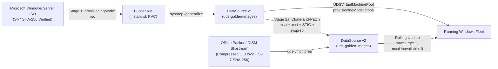

# Windows Server Lifecycle, Patching & DISA STIG Compliance Runbook

This runbook documents and tests the complete lifecycle for **Windows Server 2022** workloads managed by `uds-vm-operator`—from initial Golden Image creation (`v1`), through `.msu` Cumulative Updates and in-cluster clone-and-patch updates (`v2`), to **DISA STIG** hardening and **NIST 800-53 (`SI-7`, `SC-7`, `AC-3`, `IA-5`)** verification.

---

## Architecture Overview



---

## Workflow A: Creating Base Golden Image `v1`

You can create `v1` either **in-cluster** (Stage 1 ISO install for vendor-media chain-of-custody) or **offline** via Packer.

### Option A1 — In-Cluster Stage 1 ISO Build
1. **Deploy the Stage 1 Builder VM** ([windows-golden-builder.yaml](file:///home/bjarrett/Projects/uds-vm-operator/manifests/examples/windows-golden-builder.yaml)):
   ```bash
   kubectl create namespace uds-golden-images --dry-run=client -o yaml | kubectl apply -f -
   kubectl apply -f manifests/examples/windows-golden-builder.yaml
   ```
   - `provisioningMode: iso` emits `windowsPE` + `specialize` + `oobeSystem` `Autounattend.xml`.
   - `dataDisks` contains `name: installdisk` (`retentionPolicy: Retain`), so the operator installs Windows onto a **persistent PVC** (`win2022-golden-builder-data-installdisk`) instead of an ephemeral `emptyDisk`.
2. **Upload the Windows Server ISO with SI-7 Checksum Verification:**
   ```bash
   virtctl image-upload dv win2022-golden-builder-dv -n uds-golden-images \
     --image-path=/path/to/windows-server-2022.iso \
     --no-create --insecure
   ```
3. **Apply STIG Baseline & Generalize Inside the Builder VM:**
   Once Windows finishes `oobeSystem` and `qemu-ga` is running, run [`prepare-golden-image.ps1`](file:///home/bjarrett/Projects/uds-vm-operator/images/windows/scripts/prepare-golden-image.ps1) (which invokes [`apply-disa-stig.ps1`](file:///home/bjarrett/Projects/uds-vm-operator/images/windows/scripts/apply-disa-stig.ps1)) and generalizes the disk:
   ```powershell
   .\prepare-golden-image.ps1 -RunSysprep
   ```
4. **Promote the PVC to `DataSource` `windows-server-2022-v1`:**
   After the builder VM powers off cleanly, delete the builder `UDSVirtualMachine` (the `installdisk` PVC survives because `retentionPolicy: Retain` omits `OwnerReferences`) and verify `DataSource` `windows-server-2022-v1` is `Ready`.

### Option A2 — Offline Packer + Compressed QCOW2 Build
```bash
cd images/windows
packer build \
  -var="iso_url=/path/to/windows-server-2022.iso" \
  -var="iso_checksum=sha256:<ISO_SHA256>" \
  windows-server-2022.pkr.hcl

# Inspect, validate zero backing chains, compute SI-7 SHA-256, and generate DataSource + VM YAML
uds-vmctl prep --os windows --golden-image output-win2022-golden/windows-server-2022-golden.qcow2
```

---

## Workflow B: Updating `v1` $\rightarrow$ `v2` (Patch Tuesday `.msu` & Software Updates)

### Method B1 — Offline DISM `.msu` Slipstreaming
When updating an offline WIM or mounted VHDX before re-packaging as compressed QCOW2:
```powershell
.\images\windows\scripts\slipstream-wim.ps1 `
  -WimPath C:\Media\sources\install.wim `
  -ImageIndex 2 `
  -VirtioDriversPath D:\ `
  -UpdatesPath C:\Updates\2026-11-CU
```
Then build/compress to QCOW2 (`qemu-img convert -f qcow2 -O qcow2 -c`), run `uds-vmctl prep --os windows --golden-image ...`, and upload `windows-server-2022-v2` with its new **SI-7** SHA-256.

### Method B2 — In-Cluster Clone-and-Patch Builder (`v1` $\rightarrow$ `v2`)
To patch `v1` **without** re-running ISO setup:
1. Clone `windows-server-2022-v1` into a temporary builder `UDSVirtualMachine` (`sourceType: dataSource`, `dataSourceName: windows-server-2022-v1`, `provisioningMode: clone`).
2. Inside the builder VM, stage your `.msu` Cumulative Updates in `C:\UDS\Updates\`, install/update any third-party `.msi`/`.exe` application software, and run:
   ```powershell
   .\prepare-golden-image.ps1 -UpdatesDir C:\UDS\Updates -RunSysprep
   ```
3. Once the builder VM shuts down, promote its root PVC (`<builder>-dv`) to `DataSource` `windows-server-2022-v2` in `uds-golden-images`.
   *(Tip: If exporting to an air-gapped enclave, `qemu-img convert -c` the PVC image to compressed QCOW2 and run `uds-vmctl prep` so the `v2` artifact carries an immutable `SI-7` SHA-256 in `zarf.yaml`.)*

### Rolling Out `v2` to the Fleet
Update `spec.template.spec.disk.dataSourceName` in [windows-server-pool.yaml](file:///home/bjarrett/Projects/uds-vm-operator/manifests/examples/windows-server-pool.yaml) from `windows-server-2022-v1` to `windows-server-2022-v2`:
```bash
kubectl apply -f manifests/examples/windows-server-pool.yaml
kubectl get udsvmpool win2022-app-pool -w
```
`PoolReconciler` surges a `v2` replica (`maxSurge: 1`), waits for `Phase == "Ready"`, and drains the `v1` replica (`maxUnavailable: 0`).
- **Stateless / per-replica `dataDisks`:** Use `RollingUpdate` (`maxSurge: 1, maxUnavailable: 0`).
- **Shared single `ReadWriteOnce` `pvcName` `dataDisk`:** Use `strategy.type: Recreate` so the old VM releases the `RWO` PVC before the new VM mounts it.

---

## Workflow C: Implementing & Verifying DISA STIG Changes

DISA STIG controls split cleanly into **Golden-Image-baked controls** (applied before `sysprep /generalize`) and **per-VM runtime controls** (enforced by `uds-vm-operator`):

| Layer | Controls Enforced | Mechanism | Survives `sysprep`? |
| :--- | :--- | :--- | :--- |
| **Hardware / Hypervisor** | UEFI Secure Boot, SMM, vTPM 2.0, Hyper-V Enlightenments | [`BuildVirtualMachine`](file:///home/bjarrett/Projects/uds-vm-operator/pkg/controller/reconciler.go) (`enableSecureBootTPM: true`) | N/A (KubeVirt) |
| **Network Boundary (`SC-7`)** | Default-deny ingress/egress (DNS 53 only) | [`BuildZeroTrustNetworkPolicy`](file:///home/bjarrett/Projects/uds-vm-operator/pkg/controller/reconciler.go) | N/A (Kubernetes) |
| **OS Baseline (STIG)** | DoD GPOs (`LGPO.exe`), FIPS 140 (`FipsAlgorithmPolicy`), TLS 1.2+, SMBv1 off + SMB signing, LSA `RunAsPPL`, `secedit` Account Lockout/Password Policy, `auditpol`, Firewall | [`apply-disa-stig.ps1`](file:///home/bjarrett/Projects/uds-vm-operator/images/windows/scripts/apply-disa-stig.ps1) | **Yes** |
| **Per-VM Identity (`IA-5`)** | Unique 24-char Admin password, unique 15-char NetBIOS `ComputerName`, unique machine SID | [`BuildWindowsAutounattendXML`](file:///home/bjarrett/Projects/uds-vm-operator/pkg/controller/reconciler.go) (`specialize` + `oobeSystem`) | Applied post-`sysprep` |

### Adding a New DISA STIG Change
1. Update [`apply-disa-stig.ps1`](file:///home/bjarrett/Projects/uds-vm-operator/images/windows/scripts/apply-disa-stig.ps1) (or drop updated DoD STIG GPO backups into `C:\UDS\STIG\GPOs` for `LGPO.exe`).
2. Run **Workflow B2** (or Packer build) to bake the STIG change into Golden Image `v3` and generalize with `sysprep`.
3. Roll `v3` across the fleet via `UDSVirtualMachinePool`.

---

## Workflow D: Live Verification on `kubevirt-sandbox`

1. **Automated Unit Verification (Local):**
   ```bash
   go test -count=1 -race ./...
   ```
2. **Cluster Deployment & Compliance Verification (`kubevirt-sandbox`):**
   ```bash
   # Apply updated v0.6.0 CRDs
   kubectl apply -f manifests/crd/udsvirtualmachines.uds.dev.yaml
   kubectl apply -f manifests/crd/udsvirtualmachinepools.uds.dev.yaml

   # Verify Golden Image SI-7 & Pool readiness
   kubectl get dv,datasource -n uds-golden-images
   kubectl get udsvmpool,udsvm -A
   bin/uds-vmctl inventory

   # Run Lula OSCAL Continuous ATO assessment
   make lula-validate
   ```
