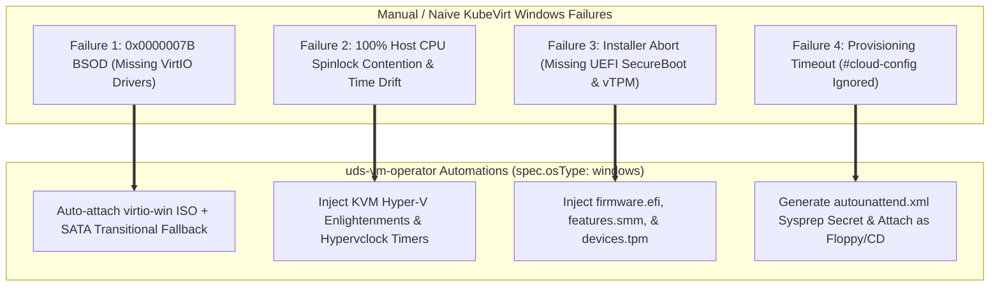

# Windows Virtual Machines on KubeVirt: Architecture, Failure Modes & Remediation Guide

This guide documents the technical architecture, failure modes, diagnostic workflows, and automated remediations for running Windows virtual machines (Windows Server 2019/2022, Windows 10/11) on Kubernetes with **KubeVirt**, Containerized Data Importer (CDI), and `uds-vm-operator`.

---

## 1. Architectural Overview: Windows Guest vs. Linux on KVM

Running Linux virtual machines on KubeVirt is relatively straightforward: modern Linux kernels include native upstream VirtIO drivers (`virtio_blk`, `virtio_net`, `virtio_balloon`, `virtio_pci`) and standard cloud-init NoCloud support out of the box.

Windows workloads introduce **four fundamental architectural differences**:
1. **Proprietary Driver Model:** Microsoft does not ship Red Hat / Linux Foundation VirtIO drivers in default installation media.
2. **Kernel Hypervisor Paravirtualization Interface:** Windows kernels expect Microsoft Hyper-V interfaces. On native Linux KVM, without explicit **Hyper-V Enlightenments**, Windows guests fall back to expensive CPU emulation traps for spinlocks, timer ticks, and APIC interrupts.
3. **Firmware & Hardware Security Requirements:** Modern Windows (Windows 11 and Windows Server 2022+ in DISA STIG configurations) mandate **UEFI Secure Boot**, System Management Mode (SMM), and a **vTPM 2.0 (Trusted Platform Module)**.
4. **Unattended Provisioning Model:** Windows ignores Linux `#cloud-config` user-data unless third-party software (like Cloudbase-Init) is pre-installed. Native Windows image provisioning requires Sysprep with an `autounattend.xml` answer file.

---

## 2. The Four Classic Failure Modes & How `uds-vm-operator` Remediates Them



---

### Failure Mode 1: Stop Code `0x0000007B` (`INACCESSIBLE_BOOT_DEVICE`)

#### The Symptom:
A Windows VM is provisioned on KubeVirt. The `virt-launcher` pod runs, but inspecting the VNC/serial console via `virtctl vnc <vm>` or `virtctl console <vm>` shows Windows loading dots for 5 seconds, followed by a Blue Screen of Death (BSOD):
```text
Your device ran into a problem and needs to restart.
Stop code: INACCESSIBLE_BOOT_DEVICE
```
The VM enters a continuous reboot loop (`CrashLoopBackOff` at the guest OS level).

#### Root Cause:
The VM root disk was attached to the high-performance `virtio` bus:
```yaml
domain:
  devices:
    disks:
      - name: rootdisk
        disk:
          bus: virtio   # <-- Windows has no driver for this PCI device!
```
During phase 1 of Windows kernel boot, the storage driver (`viostor.sys` or `vioscsi.sys`) is required to read the system root partition. Without it, the kernel cannot mount `C:\Windows\System32` and panics with `0x7B`.

#### Diagnostic & Investigation Workflow:
1. Connect to the KubeVirt VNC stream:
   ```bash
   virtctl vnc <vm-name>
   ```
2. Verify QEMU device tree using `virsh` inside the launcher pod or via `virtctl`:
   ```bash
   kubectl exec -it <virt-launcher-pod> -- virsh domblklist <vm-name>
   ```
3. Observe that the boot disk is mapped as `vda` (VirtIO block) rather than `sda` (SATA/IDE).

#### Remediation via `uds-vm-operator`:
When `spec.osType: windows` is set:
1. **Automated `virtio-win` Injection:** The operator automatically attaches the standard `virtio-win` containerDisk as a secondary CD-ROM (`sata` bus), making all Signed Windows VirtIO drivers (`viostor`, `NetKVM`, `vioscsi`, `balloon`) immediately available during boot and installation:
   ```yaml
   volumes:
     - name: virtio-win-drivers
       containerDisk:
         image: quay.io/kubevirt/virtio-container-disk:20261111_6cefb75928
   ```
2. **Transitional SATA Bus Support:** If importing an existing legacy Windows disk that has not had VirtIO drivers pre-installed via DISM/Sysprep, `uds-vm-operator` allows:
   ```yaml
   spec:
     osType: windows
     windowsProfile:
       diskBus: sata      # Boots reliably using native AHCI driver
       nicModel: e1000e   # Boots reliably using native Intel NIC driver
   ```
   Once the OS boots, VirtIO drivers can be installed, and `diskBus` can be toggled to `virtio` for maximum I/O throughput.

---

### Failure Mode 2: Host CPU Starvation, Lock Contention, and Clock Drift

#### The Symptom:
A Windows guest running idle on a Kubernetes node consumes 100% of an allocated host CPU core. Additionally, guest system time drifts significantly compared to NTP, causing Kerberos / Active Directory authentication failures (`KRB_AP_ERR_SKEW`).

#### Root Cause:
Windows kernels heavily utilize spinlocks for multi-core synchronization. On bare metal, spinlocks resolve in nanoseconds. In a hypervisor without Hyper-V paravirtualization, when thread A holds a lock and thread B spins waiting for it, the KVM host scheduler might deschedule thread A, leaving thread B burning 100% host CPU cycles spinning on a lock that cannot be released until thread A is rescheduled.

#### Remediation via `uds-vm-operator`:
The operator automatically injects the full suite of **KVM Hyper-V Enlightenments** into `spec.template.spec.domain.features.hyperv`:
- `relaxed: {}`: Informs Windows to relax timer checks when threads are preempted.
- `vapic: {}`: Virtual APIC acceleration, dramatically reducing VM-exits for IRQs.
- `spinlocks: { spinlocks: 8191 }`: Limits spinlock retry loops before yielding the vCPU back to the KVM host scheduler.
- `synic: {}` & `synictimer: {}`: Synthetic Interrupt Controller and timers.
- `frequencies: {}`: Informs the guest kernel of exact TSC and APIC frequencies.
- `tlbflush: {}`: Synthetic TLB flush acceleration.
- `clock.timer.hyperv: {}`: Synchronizes the Windows kernel clock directly with the KVM hypervisor clock, completely preventing Kerberos time drift.

---

### Failure Mode 3: Windows 11 / Server 2022 Installation & STIG Boot Rejection

#### The Symptom:
When booting a Windows 11 or Windows Server 2022 ISO, setup immediately aborts with:
```text
This PC can't run Windows 11.
This PC doesn't meet the minimum system requirements to install this version of Windows.
```

#### Root Cause:
Microsoft enforces three hardware security gates:
1. UEFI Firmware with Secure Boot enabled (CSM / Legacy BIOS is rejected).
2. SMM (System Management Mode) enabled in the hypervisor to isolate secure firmware variables.
3. TPM 2.0 (Trusted Platform Module) present and active for BitLocker and credential guard.

#### Remediation via `uds-vm-operator`:
When `spec.osType: windows` and `spec.windowsProfile.enableSecureBootTPM: true` (default):
```yaml
spec:
  template:
    spec:
      domain:
        features:
          smm:
            enabled: true
        firmware:
          bootloader:
            efi:
              secureBoot: true
        devices:
          tpm: {} # Attaches emulated software TPM (swtpm)
```

---

### Failure Mode 4: Automated Unattended Provisioning (`autounattend.xml`)

#### The Symptom:
Deploying a Windows VM with a standard cloud-init NoCloud Secret results in the VM ignoring hostname, password, and SSH key configurations. The VM sits at the Windows "Out-Of-Box Experience" (OOBE) setup wizard requiring manual mouse/keyboard intervention.

#### Remediation via `uds-vm-operator`:
For Windows guests, `uds-vm-operator` generates an **`autounattend.xml`** / Sysprep answer file inside the VM's config Secret.

The answer file:
1. **`PnPCustomizationsWinPE`**: Tells Windows Setup to recursively scan drive letters for VirtIO drivers (`D:\viostor\2k22\amd64`, `D:\NetKVM\2k22\amd64`).
2. **`Oobe` Automation**: Suppresses EULA prompts, network discovery popups, and user creation prompts.
3. **STIG Hardening**:
   - Enforces minimum password length and complexity.
   - Disables the built-in Guest account.
   - Automatically installs and starts the **QEMU Guest Agent** (`qemu-ga.exe`) from the attached `virtio-win` ISO so KubeVirt receives IP address telemetry and guest shutdown hooks.

---

## 3. Declarative Manifest Example: Mission-Critical Windows Server

```yaml
apiVersion: uds.dev/v1alpha1
kind: UDSVirtualMachine
metadata:
  name: tactical-windows-server
  namespace: default
  labels:
    uds.dev/security-tier: mission-critical
spec:
  cpus: 4
  memory: 8Gi
  runStrategy: Always
  osType: windows
  windowsProfile:
    diskBus: virtio
    nicModel: virtio
    injectVirtioWinISO: true
    enableHyperVEnlightenments: true
    enableSecureBootTPM: true
  disk:
    sourceType: upload
    format: raw
    virtualSizeBytes: 42949672960 # 40 GiB
    checksum: sha256:e3b0c44298fc1c149afbf4c8996fb92427ae41e4649b934ca495991b7852b855
  securityProfile:
    zeroTrustNetwork: true
```

---

## 4. Two-Stage Golden Image Factory, Slipstreaming & Fleet Rolling Updates

For production fleets (`UDSVirtualMachinePool`), running full `windowsPE` ISO setup on every replica takes 15–30+ minutes. `uds-vm-operator` supports a deterministic **two-stage Golden Image workflow** (see [ADR 0004](adr/0004-windows-two-stage-golden-image-factory.md) and [ADR 0005](adr/0005-windows-sysprep-provisioning-modes.md)):

1. **Stage 1 — Initial Baseline via In-Cluster ISO Install (`provisioningMode: iso`):**
   - See `manifests/examples/windows-golden-builder.yaml`: uploads the vendor-signed ISO with **SI-7** SHA-256 verification and installs onto a persistent `dataDisks` PVC (`name: installdisk`, `retentionPolicy: Retain`).
   - Run `images/windows/scripts/prepare-golden-image.ps1 -RunSysprep` to install `qemu-ga`, apply STIG baselines, clean WinSxS, and execute `sysprep /generalize /oobe /shutdown`.
   - Promote the PVC to a CDI `DataSource` (`windows-server-2022-v1`) in `uds-golden-images`.
2. **Stage 2 — Fast Slipstreamed / Patched Images (`provisioningMode: clone`):**
   - Build patched `v2` images offline using Packer + compressed QCOW2 (`images/windows/windows-server-2022.pkr.hcl` and `images/windows/scripts/slipstream-wim.ps1`) or by cloning `v1` in-cluster, applying `.msu` updates, and re-running `sysprep /generalize /oobe /shutdown`.
   - Generate manifests via `uds-vmctl prep --os windows --golden-image windows-server-2022-golden.qcow2`, which explicitly sets `provisioningMode: clone` and `injectVirtioWinISO: false` (since VirtIO drivers and `qemu-ga` are already slipstreamed).
   - Cloned `UDSVirtualMachinePool` replicas (`manifests/examples/windows-server-pool.yaml`) boot through `specialize` $\rightarrow$ `oobeSystem` in **~1–3 minutes** with unique SIDs, collision-free 15-char NetBIOS hostnames, and per-VM 24-char `IA-5` passwords.

